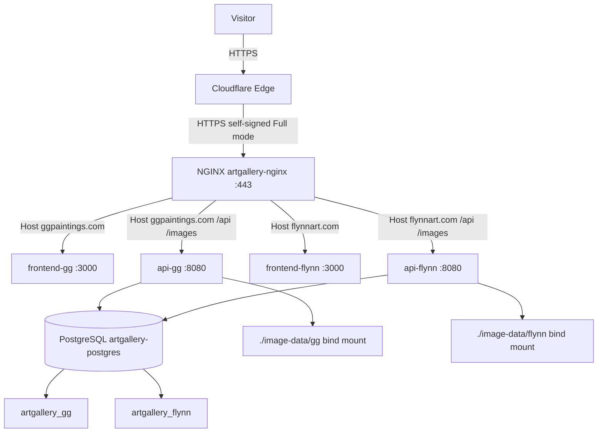

# Cloudflare + Multi-Site Migration Plan: Adding flynnart.com

> **Goal:** Bring `flynnart.com` live behind Cloudflare on the same Linux home server as
> `ggpaintings.com`, by migrating the production deployment from single-site
> (`docker-compose.prod.yml`) to multi-site (`docker-compose.multi.yml`).
>
> **Current state:** `ggpaintings.com` is live in production via `docker-compose.prod.yml`
> (single site, DB `artgallery`, images in named volume `image_data`). `flynnart.com` is not yet deployed.
>
> **Target state:** Both sites served by one NGINX container + one PostgreSQL container
> (separate databases `artgallery_gg` / `artgallery_flynn`), each behind Cloudflare in **Full** SSL mode.

---

## 1. Architecture



**Key facts (verified against the repo):**

| Concern | Detail |
|---|---|
| NGINX config | [`docker-compose/nginx/nginx.conf`](docker-compose/nginx/nginx.conf) is **already complete** for both sites: Cloudflare real-IP block (lines 32-87), per-site `server_name` blocks (gg lines 155-315, flynn lines 320-480), HTTP→HTTPS redirect for both domains (lines 486-490). **No NGINX edits required.** |
| SSL mode | Cloudflare **Full** (not Flexible, not Full Strict). Origin uses **self-signed** certs. |
| Databases | Single-site: `artgallery`. Multi-site: `artgallery_gg` + `artgallery_flynn`. |
| Volume sharing | Both compose files live in `docker-compose/` → same Compose project name `docker-compose` → **same `postgres_data` volume**. The existing `artgallery` DB is preserved across the migration. |
| Init script | [`docker-compose/scripts/init-databases.sql`](docker-compose/scripts/init-databases.sql) only runs on a **first** (empty) data dir. It will **NOT** run on the existing volume, so the two new DBs must be created manually. |
| Auto-migrate/seed | [`ServerApp/ServerApp.Infrastructure/Services/AppInitializer.cs`](ServerApp/ServerApp.Infrastructure/Services/AppInitializer.cs) runs `MigrateAsync` (does **not** create the DB) then `SeedAsync` on startup. An empty `artgallery_flynn` auto-migrates + auto-seeds; a populated `artgallery_gg` skips both. |
| Images | [`docker-compose/image-data/gg/`](docker-compose/image-data/gg) and [`docker-compose/image-data/flynn/`](docker-compose/image-data/flynn) are **committed to git** (not gitignored) and pre-populated. Production uploads live in the named volume `image_data` and must be merged into `./image-data/gg/`. |
| Env file | [`docker-compose/.env.multi.example`](docker-compose/.env.multi.example) defines all `GG_*` / `FLYNN_*` vars but is **missing `POSTGRES_PASSWORD`** (required by the compose connection strings). |
| SSL cert dirs | [`docker-compose/nginx/ssl/gg/`](docker-compose/nginx/ssl/gg) and [`docker-compose/nginx/ssl/flynn/`](docker-compose/nginx/ssl/flynn) are **both empty** — certs must be generated. |
| Deploy script | [`docker-compose/deploy-multi.sh`](docker-compose/deploy-multi.sh) pre-flight checks `secrets/postgres_password`, SSL certs in both dirs, and `nginx.conf`; sets UID-101 permissions; starts postgres; restores per-site backups if present; builds + starts the rest; runs non-root security checks. |
| Backup | [`docker-compose/scripts/backup-multi.sh`](docker-compose/scripts/backup-multi.sh) targets container `artgallery-postgres` and DBs `artgallery_gg`/`artgallery_flynn`. Install via [`docker-compose/scripts/install-backup-cron-multi.sh`](docker-compose/scripts/install-backup-cron-multi.sh). |

---

## 2. Phase 1 — Preparation (do while `ggpaintings.com` is still live)

These steps cause **no downtime**. Complete them before the cutover.

### 2.1 Create `.env.multi`

```bash
cd docker-compose
cp .env.multi.example .env.multi
```

Edit `.env.multi`:

1. **Add the missing `POSTGRES_PASSWORD`** (required by the compose connection strings; must equal the content of `secrets/postgres_password`):
   ```bash
   # value must match: cat secrets/postgres_password
   POSTGRES_PASSWORD=<paste the existing production postgres password>
   ```
2. **Carry over the existing `gg` values** from your current single-site `.env` (so gg behaves identically):
   - `GG_GOOGLE_AUTH_CLIENT_ID`, `GG_GOOGLE_AUTH_CLIENT_SECRET`, `GG_GOOGLE_AUTH_REDIRECT_URI`
   - `GG_YAHOO_AUTH_CLIENT_ID`, `GG_YAHOO_AUTH_CLIENT_SECRET`, `GG_YAHOO_AUTH_REDIRECT_URI`
   - `GG_ADMIN_JWT_SECRET_KEY`, `GG_ADMIN_AUTHORIZED_EMAILS`
   - All `GG_CSS_*`, `GG_SITE_*`, `GG_CONTACT_*`, `GG_FAVICON`, `GG_NAVBAR_*`
3. **Fill in the `flynn` values:**
   - `FLYNN_GOOGLE_AUTH_CLIENT_ID` / `FLYNN_GOOGLE_AUTH_CLIENT_SECRET` (from step 2.3)
   - `FLYNN_YAHOO_AUTH_CLIENT_ID` / `FLYNN_YAHOO_AUTH_CLIENT_SECRET` (from step 2.3)
   - `FLYNN_ADMIN_JWT_SECRET_KEY` — generate: `openssl rand -base64 32`
   - `FLYNN_ADMIN_AUTHORIZED_EMAILS` — the flynn admin's email
   - Confirm `FLYNN_CORS_ALLOWED_ORIGINS=https://flynnart.com,https://www.flynnart.com`
   - Confirm `FLYNN_NEXT_PUBLIC_API_URL=/api` and `FLYNN_SERVER_API_URL=http://api-flynn:8080/api`
   - Confirm `FLYNN_GOOGLE_AUTH_REDIRECT_URI=https://flynnart.com/admin/login` and `FLYNN_YAHOO_AUTH_REDIRECT_URI=https://flynnart.com/admin/login`

> `.env.multi` is gitignored (see [`docker-compose/.gitignore`](docker-compose/.gitignore)) — it will not be committed.

### 2.2 Generate self-signed SSL certificates (both sites)

Cloudflare **Full** mode terminates visitor TLS at the edge and connects to the origin over HTTPS using a self-signed cert. Generate one cert per site:

```bash
cd docker-compose

# gg
openssl req -x509 -nodes -days 3650 -newkey rsa:2048 \
  -keyout nginx/ssl/gg/server.key \
  -out nginx/ssl/gg/server.crt \
  -subj "/CN=ggpaintings.com"

# flynn
openssl req -x509 -nodes -days 3650 -newkey rsa:2048 \
  -keyout nginx/ssl/flynn/server.key \
  -out nginx/ssl/flynn/server.crt \
  -subj "/CN=flynnart.com"
```

> `deploy-multi.sh` will set ownership to UID 101 and `chmod 600` the `.key` files automatically.
> A 10-year validity (`-days 3650`) avoids renewal churn for a self-signed origin cert.

### 2.3 Create `flynn` OAuth clients (Google + Yahoo)

Each site needs its **own** OAuth clients (gg already has them). Create new ones for flynn:

**Google** (console.cloud.google.com → APIs & Services → Credentials → Create OAuth client ID → Web application):
- Authorized JavaScript origins: `https://flynnart.com`, `https://www.flynnart.com`
- Authorized redirect URIs: `https://flynnart.com/admin/login`
- Record the Client ID + Client Secret → `FLYNN_GOOGLE_AUTH_CLIENT_ID` / `FLYNN_GOOGLE_AUTH_CLIENT_SECRET`

**Yahoo / Bing Developer** (account.live.com / developer portal → Register app):
- Redirect URL: `https://flynnart.com/admin/login`
- Record the Client ID + Client Secret → `FLYNN_YAHOO_AUTH_CLIENT_ID` / `FLYNN_YAHOO_AUTH_CLIENT_SECRET`

> Reference: [`plans/google-oauth-admin-login-simplified.md`](plans/google-oauth-admin-login-simplified.md) and [`plans/yahoo-oauth-setup-guide.md`](plans/yahoo-oauth-setup-guide.md).

### 2.4 Add `flynnart.com` to Cloudflare

Mirror the existing `ggpaintings.com` setup (see [`plans/first-deployment-ubuntu-26.04.md`](plans/first-deployment-ubuntu-26.04.md) STEP 9):

1. **Add site:** Cloudflare dashboard → *Add a site* → `flynnart.com` → free plan.
2. **Nameservers:** Cloudflare shows two nameservers. At the flynnart.com registrar, replace the existing nameservers with Cloudflare's. (Propagation: minutes to 48h.)
3. **DNS records** (Cloudflare → DNS → Records):

   | Type | Name | Content | Proxy |
   |---|---|---|---|
   | A | `@` | `<SERVER_IP>` | **Proxied** (orange cloud) |
   | CNAME | `www` | `flynnart.com` | **Proxied** (orange cloud) |

   > `<SERVER_IP>` is the same public IP already used by `ggpaintings.com`. Cloudflare distinguishes the two sites by the `Host` header, which NGINX routes via `server_name`.
4. **SSL/TLS → Encryption Mode: `Full`** (NOT Flexible, NOT Full Strict).
   - *Flexible* → redirect loops (origin is HTTPS). *Full Strict* → rejects the self-signed origin cert.
5. **SSL/TLS → Edge Certificates:**
   - *Always Use HTTPS:* **On**
   - *Automatic HTTPS Rewrites:* **On**
   - *Minimum TLS Version:* **1.2**
6. **Security → Settings:**
   - *Security Level:* **Medium**
   - *Bot Fight Mode:* **On**
7. **Wait for activation:** Cloudflare shows the site as *Active* once the nameservers propagate. Verify with `dig NS flynnart.com` (should return Cloudflare's nameservers).

> Do **not** point the A record at the server until Phase 2 cutover is ready, **or** accept that flynnart.com will briefly 502 while the old single-site stack (which has no flynn server block) is still running. Recommended: add the DNS records now (harmless) and only rely on them after the multi-site stack is up.

---

## 3. Phase 2 — Cutover (single-site → multi-site)

> This is the **downtime window** for `ggpaintings.com` (from stopping the old stack until the new one is healthy). Do it in one sitting.

### 3.1 Stop the old single-site stack

The old prod nginx is named `artgallery-nginx` — the **same name** the multi-site nginx uses — so the old stack **must** be stopped first.

```bash
cd docker-compose
docker compose -f docker-compose.prod.yml down
# Confirm nothing is left:
docker ps --format '{{.Names}}' | grep -E 'artgallery' || echo "all stopped"
```

> The `postgres_data` volume is **not** removed by `down` (no `-v` flag), so the `artgallery` DB is preserved.

### 3.2 Start multi-site PostgreSQL

```bash
cd docker-compose
docker compose -f docker-compose.multi.yml up -d postgres
# Wait for healthy (container: artgallery-postgres)
docker inspect -f '{{.State.Health.Status}}' artgallery-postgres
# (repeat until "healthy")
```

### 3.3 Migrate the databases

`init-databases.sql` will not run (volume not empty), so create the two DBs manually and copy the production `artgallery` data into `artgallery_gg`. `artgallery_flynn` is left empty so the API auto-migrates + seeds it.

```bash
cd docker-compose

# 1) Create both databases
docker exec artgallery-postgres psql -U postgres -c "CREATE DATABASE artgallery_gg;"
docker exec artgallery-postgres psql -U postgres -c "CREATE DATABASE artgallery_flynn;"

# 2) Copy production data: artgallery -> artgallery_gg (custom-format dump + restore)
docker exec artgallery-postgres pg_dump -U postgres -Fc -f /tmp/gg_migrate.dump artgallery
docker exec artgallery-postgres pg_restore -U postgres -d artgallery_gg /tmp/gg_migrate.dump
docker exec artgallery-postgres rm -f /tmp/gg_migrate.dump

# 3) Verify
docker exec artgallery-postgres psql -U postgres -d artgallery_gg -c "SELECT count(*) FROM Paintings;"
docker exec artgallery-postgres psql -U postgres -d artgallery_gg -c "SELECT count(*) FROM PaintingCategories;"
docker exec artgallery-postgres psql -U postgres -d artgallery_gg -c "SELECT count(*) FROM AdminUsers;"
```

> `artgallery_flynn` is intentionally left empty. When `api-flynn` starts, [`AppInitializer`](ServerApp/ServerApp.Infrastructure/Services/AppInitializer.cs) applies all EF migrations (creating the schema) and [`DatabaseSeeder`](ServerApp/ServerApp.Infrastructure/Services/DatabaseSeeder.cs) seeds the 2 flynn categories (`paintings`, `ceramics`), the flynn paintings/ceramics, and flynn page content.
>
> **Do not drop the old `artgallery` DB yet** — keep it as a rollback safety net until Phase 3 verification passes.

### 3.4 Migrate gg images (named volume → bind mount)

The multi-site `api-gg` reads images from the bind mount `./image-data/gg` (already committed with seed images). Production uploads live in the named volume `image_data` and must be merged in so nothing is lost.

```bash
cd docker-compose

# Confirm the exact volume name (expected: docker-compose_image_data)
docker volume ls | grep -E 'image_data|postgres_data'

# Copy the live volume contents into the bind mount (volume is the source of truth)
docker run --rm \
  -v docker-compose_image_data:/src:ro \
  -v "$(pwd)/image-data/gg":/dst \
  alpine sh -c "cp -a /src/. /dst/"

# Sanity check
ls image-data/gg/high-res | head
ls image-data/gg/thumbnail | head
```

> `image-data/flynn` is already committed and complete — no action needed.
> If the volume name differs from `docker-compose_image_data`, substitute the actual name from `docker volume ls`.

### 3.5 Deploy the multi-site stack

```bash
cd docker-compose
./deploy-multi.sh
```

What `deploy-multi.sh` does:
1. Loads `.env.multi`, runs pre-flight checks (secrets, SSL certs in both dirs, `nginx.conf`).
2. Sets UID-101 ownership on SSL dirs + `nginx.conf`, `chmod 600` the `.key` files.
3. `down` (no-op for multi-site) → starts `postgres` → waits for healthy.
4. Restores per-site backups from `$BACKUP_DIR` **if present** — there are none for multi-site yet, so it skips (your manually-migrated `artgallery_gg` is preserved).
5. `up -d --build` — builds + starts `api-gg`, `frontend-gg`, `api-flynn`, `frontend-flynn`, `nginx`.
6. Prints container status + non-root security checks.

> The `down`/`up postgres` inside the script is harmless: the `postgres_data` volume persists, so `artgallery_gg` and `artgallery_flynn` survive the restart.

---

## 4. Phase 3 — Verification

### 4.1 Container health

```bash
cd docker-compose
docker compose -f docker-compose.multi.yml ps
# All 6 should be "healthy": artgallery-postgres, artgallery-api-gg,
# artgallery-frontend-gg, artgallery-api-flynn, artgallery-frontend-flynn, artgallery-nginx
```

### 4.2 Site verification (through Cloudflare)

```bash
# gg (must still work, unchanged)
curl -sI https://ggpaintings.com | head -5
curl -s https://ggpaintings.com/api/paintings | head -c 200

# flynn (new)
curl -sI https://flynnart.com | head -5
curl -s https://flynnart.com/api/paintings | head -c 200
curl -s https://flynnart.com/api/painting-categories | head -c 200
```

Expected: `200` responses; flynn `/api/paintings` returns the seeded flynn paintings; `/api/painting-categories` returns `paintings` + `ceramics`.

Also verify in a browser:
- `https://flynnart.com` renders the flynn theme (light background, "Artwork"/"Events" nav labels).
- `https://www.flynnart.com` redirects/serves correctly.
- `http://flynnart.com` 301-redirects to `https://flynnart.com`.
- `https://ggpaintings.com` is unchanged.

### 4.3 Database verification

```bash
docker exec artgallery-postgres psql -U postgres -d artgallery_flynn -c "SELECT count(*) FROM Paintings;"
docker exec artgallery-postgres psql -U postgres -d artgallery_flynn -c "SELECT slug FROM PaintingCategories;"
# Expect: paintings count > 0; categories = paintings, ceramics
```

### 4.4 Cloudflare verification

- Cloudflare dashboard → `flynnart.com` → **SSL/TLS**: mode is **Full**, no errors.
- **Analytics**: traffic is flowing (orange-cloud proxied).
- `curl -sI https://flynnart.com | grep -i server` → `cloudflare`.
- Confirm the origin is reached over HTTPS: NGINX access logs show real client IPs (Cloudflare `CF-Connecting-IP`), not Cloudflare edge IPs.

### 4.5 Admin login smoke test (flynn)

- Visit `https://flynnart.com/admin/login`.
- Click **Sign in with Google** → completes → lands on the flynn admin dashboard (confirms flynn Google OAuth + JWT + authorized-emails work).
- Repeat with **Yahoo**.

---

## 5. Phase 4 — Post-Deployment

### 5.1 Switch backups to multi-site

The old single-site cron (from `install-backup-cron.sh`) targets `artgallery-postgres-prod` / `artgallery`. Replace it with the multi-site backup:

```bash
cd docker-compose
sudo ./scripts/install-backup-cron-multi.sh
```

This:
- Creates `/opt/artgallery/{scripts,backups}`.
- Installs `backup-multi.sh` + `restore-multi.sh`.
- Writes `/opt/artgallery/scripts/backup.config` with `CONTAINER_NAME=artgallery-postgres` (note: **not** `-prod`).
- Schedules a weekly cron (Sunday 02:00) and runs an initial test backup of **both** sites.

> **Note:** `install-backup-cron-multi.sh` reads `POSTGRES_PASSWORD` from `.env.multi` to write `backup.config`. Because we added `POSTGRES_PASSWORD` to `.env.multi` in step 2.1, this works. (`backup-multi.sh` itself uses `docker exec` as the postgres user and does not need the password, but the config value keeps things consistent.)

Verify the test backup produced two dumps:
```bash
ls -1 /opt/artgallery/backups/artgallery_artgallery_gg_*.dump
ls -1 /opt/artgallery/backups/artgallery_artgallery_flynn_*.dump
```

Remove the old single-site cron entry if present:
```bash
crontab -l | grep backup.sh   # if present: crontab -e and delete the line
```

### 5.2 Clean up old single-site artifacts (after confirming stability for a few days)

```bash
cd docker-compose
# Drop the now-unused single-site database (only after artgallery_gg is confirmed good)
docker exec artgallery-postgres psql -U postgres -c "DROP DATABASE artgallery;"
# Remove the now-unused named image volume (only after image-data/gg is confirmed complete)
docker volume rm docker-compose_image_data
```

> Keep `docker-compose.prod.yml` in the repo as a reference/rollback artifact; it is simply no longer used in production.

---

## 6. Rollback Plan

If the multi-site deployment fails and `ggpaintings.com` must be restored quickly:

1. **Stop multi-site:** `docker compose -f docker-compose.multi.yml down`
2. **Restore gg data** (the old `artgallery` DB was preserved in the shared volume and was **not** dropped in Phase 2):
   - If `artgallery` still exists, the single-site stack can start directly against it.
   - If it was dropped, restore from the latest single-site backup (`/opt/artgallery/backups/artgallery_db_*.dump`) or from `artgallery_gg` (which holds the same data).
3. **Restart single-site:** `docker compose -f docker-compose.prod.yml up -d --build`
4. **Cloudflare:** `ggpaintings.com` DNS/SSL are unchanged by this migration, so gg continues to work. For flynn, simply leave the DNS records in place (harmless) or set them to *DNS only* (grey cloud) until the issue is resolved.

> The single biggest rollback safety net is **not dropping `artgallery`** until Phase 3 verification fully passes (see step 5.2).

---

## 7. Checklist

**Phase 1 (no downtime)**
- [ ] `.env.multi` created; `POSTGRES_PASSWORD` added; gg values carried over; flynn values filled in
- [ ] Self-signed certs generated in `nginx/ssl/gg/` and `nginx/ssl/flynn/`
- [ ] flynn Google OAuth client created (redirect `https://flynnart.com/admin/login`)
- [ ] flynn Yahoo OAuth client created (redirect `https://flynnart.com/admin/login`)
- [ ] flynnart.com added to Cloudflare; nameservers changed
- [ ] DNS: A `@` → `<SERVER_IP>` (proxied), CNAME `www` → `flynnart.com` (proxied)
- [ ] Cloudflare: SSL **Full**, Always Use HTTPS On, Auto HTTPS Rewrites On, Min TLS 1.2, Security Medium, Bot Fight On

**Phase 2 (cutover / downtime)**
- [ ] Old single-site stack stopped (`docker compose -f docker-compose.prod.yml down`)
- [ ] Multi-site postgres started + healthy
- [ ] `artgallery_gg` + `artgallery_flynn` created
- [ ] `artgallery` data restored into `artgallery_gg`
- [ ] gg images copied from named volume `image_data` → `./image-data/gg/`
- [ ] `./deploy-multi.sh` run successfully (all 6 containers healthy, non-root checks pass)

**Phase 3 (verification)**
- [ ] All 6 containers healthy
- [ ] `https://ggpaintings.com` unchanged (200, correct content)
- [ ] `https://flynnart.com` + `https://www.flynnart.com` serve flynn content (200)
- [ ] `http://flynnart.com` → 301 → `https://flynnart.com`
- [ ] flynn DB seeded (paintings > 0; categories = paintings, ceramics)
- [ ] Cloudflare serving flynn (server header `cloudflare`, real IPs in NGINX logs)
- [ ] flynn admin login works via Google and Yahoo

**Phase 4 (post-deployment)**
- [ ] `sudo ./scripts/install-backup-cron-multi.sh` run; test backups for both sites exist
- [ ] Old single-site cron removed
- [ ] (After stability) `artgallery` DB dropped + `image_data` volume removed

---

## 8. Key File References

| File | Role |
|---|---|
| [`docker-compose/docker-compose.multi.yml`](docker-compose/docker-compose.multi.yml) | Target multi-site stack (postgres, api/frontend ×2, nginx) |
| [`docker-compose/docker-compose.prod.yml`](docker-compose/docker-compose.prod.yml) | Current single-site stack (to be retired) |
| [`docker-compose/nginx/nginx.conf`](docker-compose/nginx/nginx.conf) | Already complete for both sites + Cloudflare real-IP |
| [`docker-compose/.env.multi.example`](docker-compose/.env.multi.example) | Template for `.env.multi` (add `POSTGRES_PASSWORD`) |
| [`docker-compose/deploy-multi.sh`](docker-compose/deploy-multi.sh) | Multi-site deploy (permissions, postgres, restore, build, security checks) |
| [`docker-compose/scripts/init-databases.sql`](docker-compose/scripts/init-databases.sql) | Creates both DBs (only on first/empty volume) |
| [`docker-compose/scripts/backup-multi.sh`](docker-compose/scripts/backup-multi.sh) | Multi-site DB backup (both sites) |
| [`docker-compose/scripts/install-backup-cron-multi.sh`](docker-compose/scripts/install-backup-cron-multi.sh) | Installs multi-site backup cron |
| [`ServerApp/ServerApp.Infrastructure/Services/AppInitializer.cs`](ServerApp/ServerApp.Infrastructure/Services/AppInitializer.cs) | Auto-migrate + seed on API startup |
| [`ServerApp/ServerApp.Infrastructure/Services/DatabaseSeeder.cs`](ServerApp/ServerApp.Infrastructure/Services/DatabaseSeeder.cs) | Seeds site-specific data when DB is empty |
| [`plans/first-deployment-ubuntu-26.04.md`](plans/first-deployment-ubuntu-26.04.md) | Reference Cloudflare config (STEP 9) + multi-site backups (STEP 10) |
