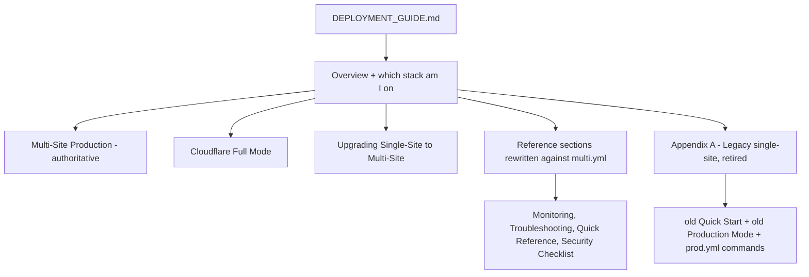

# Docs Correction + Runtime-Data Hygiene

**Scope:** (A) correct `DEPLOYMENT_GUIDE.md` + `scripts/README.md` so the current
multi-site stack is the documented default and the retired single-site stack is
quarantined; (B) close the real gaps in `docker-compose/.gitignore`.

**Decision taken:** `image-data/` stays tracked. It is seed fixture data, not
runtime churn. No `git rm --cached`, no ignore rule for that path.

---

## Part A - Why the docs are a problem

`DEPLOYMENT_GUIDE.md` (1790 lines) contains **four** deployment walkthroughs plus a
cutover section. Two of them deploy the retired stack, and they sit *earlier* in the
document than the correct ones:

| Lines | Section | Stack it deploys | Verdict |
|-------|---------|------------------|---------|
| 254-443 | Quick Start: Deploy to ggpaintings.com | `prod.yml` + `deploy.sh` | legacy, but reads as the default |
| 493-638 | Production Mode (Deployment) | `prod.yml` | legacy duplicate |
| 639-777 | Cloudflare Full Mode (Home Server) | `multi.yml` + `deploy-multi.sh` | correct |
| 778-1171 | Multi-Site Production Deployment | `multi.yml` + `deploy-multi.sh` | correct, authoritative |
| 1173-1311 | Upgrading a Single-Site Server to Multi-Site | cutover | correct |

After those, the *generic* reference sections (Monitoring, Troubleshooting, Quick
Reference, Security Checklist, Switching Modes, Updating Code, Database Restore) all
default to `docker-compose.prod.yml` and to `-prod` container names that do not exist
in the multi-site stack.

Reading order is the bug. A new operator following the guide top-to-bottom deploys the
retired stack, and every verification command they then run targets containers named
`artgallery-api-prod` / `artgallery-postgres-prod` that were never created.

### Three concrete defects, not just cosmetic drift

1. **SSL layout is wrong in the legacy sections.** Lines 328-342 and 559-586 create a
   flat `nginx/ssl/server.crt`. The multi-site stack mounts `nginx/ssl/gg` and
   `nginx/ssl/flynn` separately (`docker-compose.multi.yml:281-282`) and
   `deploy-multi.sh:61-75` fails pre-flight unless both per-site dirs exist. Following
   the Quick Start produces a config NGINX cannot boot.
2. **The certbot cron at line 1549 restarts the wrong stack** —
   `certbot renew && docker-compose -f docker-compose.prod.yml restart nginx`. On a
   Cloudflare Full + self-signed origin setup, certbot is not in play at all.
3. **Database Restore (1509-1522) restores into `artgallery` on `artgallery-postgres-prod`.**
   Copy-pasted on a multi-site server this either no-ops or hits the wrong database.

### Target structure



### Reference-section rewrite table

Every entry below currently names `prod.yml` or a `-prod` container. Target is
`docker-compose.multi.yml` and the real multi-site service/container names:
`postgres`, `api-gg`, `api-flynn`, `frontend-gg`, `frontend-flynn`, `nginx`;
containers `artgallery-postgres`, `artgallery-api-gg`, `artgallery-api-flynn`,
`artgallery-frontend-gg`, `artgallery-frontend-flynn`, `artgallery-nginx`.

| Lines | Section | Fix |
|-------|---------|-----|
| 1340-1378 | Switching Between Modes | dev to multi and back; drop prod.yml path |
| 1380-1394 | Key Differences table | compare Development vs Multi-Site, not vs prod.yml |
| 1428-1451 | Updating Application Code, In Production | `deploy-multi.sh` first, `multi.yml` second |
| 1455-1476 | View Logs / Restart Services | multi.yml; service names `api-gg` not `api` |
| 1478-1507 | Database Backup | keep both scripts but label `backup.sh` legacy; note the `artgallery_db_*` vs `artgallery_artgallery_gg_*` filename glob mismatch already documented at 1225-1228 |
| 1509-1522 | Database Restore | `restore-multi.sh`; correct container + per-site database |
| 1543-1550 | SSL/TLS Auto-Renewal | state that Cloudflare Full uses self-signed certs and certbot does not apply; if kept, the cron must restart the multi stack |
| 1562-1656 | Troubleshooting | all `prod.yml` logs commands and `artgallery-postgres-prod` / `artgallery` DB probes |
| 1691-1726 | Quick Reference, Production Commands | multi.yml equivalents |
| 1728-1783 | Security Checklist + Verify Security Configuration | multi container names |
| 13-31 | Overview table + legacy note | mark `prod.yml` Retired, point at Appendix A |
| 33-39 | Deployment Options table | same |

Plus `scripts/README.md:147-148` (the "port 8080 is not published in
`docker-compose.prod.yml`" note) and `:171-172` (a `prod.yml up -d` snippet).

### Guardrail to add

A short "which stack am I on?" block near the top, so operators can tell before
running anything:

```bash
docker ps --format '{{.Names}}' | grep -E 'artgallery-(api|frontend|nginx|postgres)' || echo "nothing running"
```

`-prod` suffix present means the retired stack is live.

---

## Part B - gitignore / runtime-data findings

### B1. The `backups/` gap is real and it is a secret leak

All four backup generators emit **`.dump`** files:

- `scripts/backup.sh:21` -> `artgallery_db_$TIMESTAMP.dump`
- `scripts/backup-multi.sh:41` -> `artgallery_${db}_${TIMESTAMP}.dump`
- `scripts/create-local-backup.ps1:97` and `create-local-backup-multi.ps1:132` -> `.dump`

`docker-compose/.gitignore:16-18` ignores only `backups/*.bak`, `backups/*.sha256`,
`backups/*.log`. **`.dump` is not matched.** A `pg_dump -Fc` archive of `artgallery_gg`
contains every `AdminUser` row, including emails, Google `sub` and Yahoo `guid`.

Fix: replace the three extension lines with a single `backups/` rule. The directory is
created by the scripts (`create-local-backup.ps1:90-92`) and holds nothing that should
be committed.

### B2. `image-data/` stays tracked - and the docs must stop telling people otherwise

`DEPLOYMENT_GUIDE.md:1309-1311` currently recommends adding `image-data/` to
`.gitignore`. That advice is wrong twice over:

- `.gitignore` is inert for already-tracked paths, so the rule would do nothing without
  a `git rm -r --cached`.
- Untracking it breaks the documented `git pull` deploy path. Seed data hard-codes the
  paths: `FlynnPaintingsSeedData.cs:26` -> `/images/high-res/B_W_Bird_12_16.jpeg`,
  served from `StoragePath: /app/images` (`appsettings.Production.json:18`) bound from
  `./image-data/flynn` (`docker-compose.multi.yml:192`). A clone with no `image-data/`
  yields a seeded database whose every painting 404s.

Fix: rewrite that bullet to say the directory is **intentionally tracked as seed
fixtures**, and add a comment to `.gitignore` saying so, so the advice is not
re-litigated.

### B3. Verified clean - do not "fix" these

Checked so these are not re-opened later:

- `docker-compose/.dockerignore` is effectively inert for secrets. The only build
  context inside `docker-compose/` is `./nginx`; `.env.multi` sits outside it.
- `nginx/Dockerfile` has no `COPY .` — only `COPY entrypoint.sh` — so certs in
  `nginx/ssl/` cannot be baked into the image.
- `nginx/ssl/` holds self-signed certs (top-level `server.crt`/`server.key` plus
  `gg/`, `flynn/`, `localhost/` subdirs), but root `.gitignore:11-12` already ignores
  `*.crt` / `*.key` repo-wide, so none of them can be committed. No cert rule needed.
- `.env.multi` and `.env.multi.arm64` exist on disk but are already ignored
  (`docker-compose/.gitignore:5-6`).

### B4. Audit steps that need a real git run

These require shell access and are the reason Part B is a task list, not a done deal:

```bash
git ls-files docker-compose/image-data | wc -l      # expect ~167 if tracked
git ls-files docker-compose/backups                 # expect empty
git status --porcelain docker-compose/image-data    # untracked churn?
git ls-files --others --ignored --exclude-standard  # what is being skipped today
```

`docker-compose/$null` (junk from a mis-typed PowerShell redirect) is present in the
working tree. Confirm it is untracked, delete it, and add a `$null` ignore rule.

---

## Status — executed 2026-11-05

Part A is done. The guide now opens with **Which Stack Am I On?**, keeps **Multi-Site
Production Deployment** as the authoritative path, and both `prod.yml` walkthroughs sit in
**Appendix A – Legacy Single-Site Stack (Retired)** behind a "do not run" banner. The
generic reference sections (Quick Reference, Security Checklist, Verify Security
Configuration) name `docker-compose.multi.yml`, the six multi-site services and the real
container names. `scripts/README.md` labels `backup.sh` / `restore.sh` retired and calls out
the `artgallery_db_*` glob mismatch.

Part B audit, run against the repo:

| Check | Result |
|-------|--------|
| `git ls-files docker-compose/image-data` | **167 files tracked** — confirms B2, stays tracked |
| `git ls-files docker-compose/backups` | empty; the `backups/` rule now covers `.dump` |
| Tracked files matching `.env` / `secrets/` / `.dump` / `.crt` / `.key` | only `.env.example`, `.env.multi.example`, `.env.multi.arm64.example`, `secrets/.gitkeep` |
| `git check-ignore -v` | `.env.multi`, `secrets/postgres_password`, `$null`, `backups/*.dump` all ignored |
| `docker-compose/$null` | gone from the working tree and ignored |

---

## Follow-up found while verifying (fixed)

`DEPLOYMENT_GUIDE.md`, `deploy-multi.sh`, `ServerApp.Api/Dockerfile` and three runbooks all
stated the API runs as **UID 1 `appuser`**. It does not: `mcr.microsoft.com/dotnet/aspnet:10.0`
defines `APP_UID=1654` and a user named `app`, confirmed with
`docker run --rm --entrypoint sh mcr.microsoft.com/dotnet/aspnet:10.0 -c "id"`. Neither
`docker-compose.multi.yml` nor the arm64 variant sets `user:` for `api-gg` / `api-flynn`, so
1654 is the UID that actually writes the `/app/images` bind mounts — `chown -R 1:1` handed
them to a user no container runs as.

---

## Plans-doc quarantine pass (2026-11-05)

Part A quarantined the *operational* docs. A follow-up sweep then found five files under
`plans/` that still described the retired stack as current or gave copy-pasteable commands
against it. These are historical design records, so they were annotated rather than rewritten —
each now opens with a banner pointing at `DEPLOYMENT_GUIDE.md` as the authority:

| File | Problem | Action |
|------|---------|--------|
| `flynn-deployment-runbook.md` | Called `prod.yml` "the current live stack" and valid for `down` | Superseded banner |
| `cloudflare-flynn-implementation.md` | "Current state" asserted gg runs on `prod.yml` in production | Banner + reworded to "as written, 2026-11" |
| `multi-site-implementation-plan.md` | Header "Target Command" was a `prod.yml` up command | Banner + relabelled "at time of writing" |
| `production-env-setup.md` | Step 6 Deploy ran `prod.yml` with no warning | Banner + command block now leads with `deploy-multi.sh` |
| `google-oauth-admin-login-simplified.md` | Instructed editing `prod.yml`; used unprefixed env keys | Banner noting per-site `GG_`/`FLYNN_` prefixes and that Yahoo + the admin dashboard now exist |

### `read-only-mode-architecture.md` — a real defect, not just stale framing

Its Rollback Instructions were wrong in a way that would waste an operator's time:

1. It named only `docker-compose.prod.yml`, which is retired and not deployed.
2. It showed `Database__ReadOnlyMode: ${DATABASE_READ_ONLY_MODE:-true}` needing a flip to
   `false`. **Every** compose file already defaults to `false`, so there was nothing to flip.
3. It missed that the multi-site stack uses **per-site** keys on **two** API services —
   `GG_DATABASE_READ_ONLY_MODE` on `api-gg` and `FLYNN_DATABASE_READ_ONLY_MODE` on `api-flynn`,
   in both `docker-compose.multi.yml` (L74, L183) and `docker-compose.multi.arm64.yml`
   (L91, L202). Setting the bare `DATABASE_READ_ONLY_MODE` key has no effect there.

Rewritten to list the actual files, keys and line numbers, and to rebuild with
`deploy-multi.sh`. Verified that `deploy-multi.sh` sources `.env.multi` under `set -a`, so that
file is the correct place to change these values; the arm64 path reads
`.env.multi.arm64` via `--env-file`.

---

## Out of scope

- Deleting `docker-compose.prod.yml`, `deploy.sh`, `backup.sh`, `restore.sh`. They stay,
  marked retired.
- Moving image storage to object storage.
- Any change to `deploy-multi.sh` — its pre-flight *guards* were correct. One non-guard fix
  was made afterwards, outside this plan: step 2 chowned `image-data/` to `1:1`, which is
  now `1654:1654`, and step 8 gained a `test -w /app/images/original` probe inside each API
  container so a wrong UID on the bind mount is caught at deploy time instead of at the
  first upload.