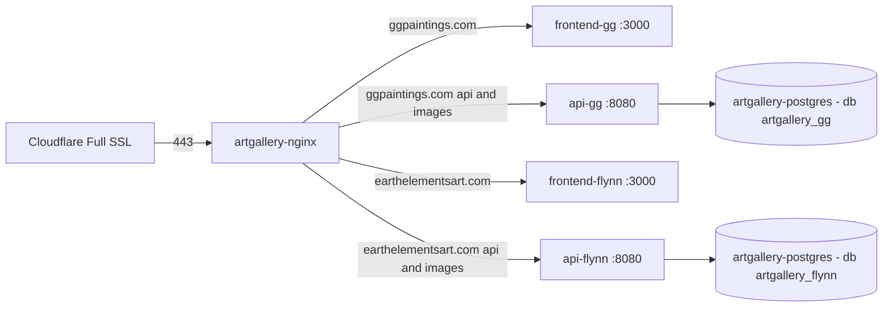

# Flynn Site Deployment Runbook (single-site → multi-site cutover)

Target: add **earthelementsart.com** alongside the live **ggpaintings.com** on the Ubuntu server,
moving from `docker-compose.prod.yml` (single site) to `docker-compose.multi.yml` (6 containers).

Verified against the repo on 2026-11-04. Everything below was checked in the actual files,
not assumed. Items marked **⚠ ACTION** need a decision or edit before deploying.

> **⚠ SUPERSEDED — historical planning doc.** Statements below that describe
> `docker-compose.prod.yml` as "the current live stack" were true on the date of writing and are
> kept for the migration rationale. `docker-compose.prod.yml` is now marked **retired** and is
> additionally *incompatible* with the current stack (it runs `artgallery-postgres-prod` with a
> single `artgallery` database, expects a flat `nginx/ssl/` cert directory, and uses `api` /
> `frontend` service names). For anything you are about to actually run, use
> [`../docker-compose/DEPLOYMENT_GUIDE.md`](../docker-compose/DEPLOYMENT_GUIDE.md) —
> **Multi-Site Production Deployment** is the authoritative path, and the retired single-site
> material lives in its Appendix A behind a do-not-run banner. Current tooling is
> `deploy-multi.sh` + `docker-compose.multi.yml`.

---

## 1. Target architecture (verified correct)



- 6 containers: `artgallery-postgres`, `artgallery-api-gg`, `artgallery-frontend-gg`,
  `artgallery-api-flynn`, `artgallery-frontend-flynn`, `artgallery-nginx`.
- nginx routing verified complete for flynn: `/api/` → `http://api_flynn/api/`,
  `/images/` → `http://api_flynn/images/`, `/_next/static/`, `/fonts/`, `/` → `frontend_flynn`.
  Upstream hostnames (`api-flynn`, `frontend-flynn`) match compose service names.
- Flynn images: seed data uses `/images/high-res/...jpeg` + `/images/thumbnail/..._.jpg`;
  API serves `/app/images` at `/images`; compose bind-mounts `./image-data/flynn` into both
  API containers. All 15 high-res + 15 thumbnail flynn files exist in `docker-compose/image-data/flynn/`.
- Healthchecks verified: API `curl` works (Dockerfile installs curl), frontend/nginx `wget`
  works (Alpine). Health route `/api/health/health` exists.
- `SITE_NAME=flynn` → `SiteSeedDataProviderFactory` resolves the Flynn provider
  (categories `paintings`, `ceramics`); empty flynn DB auto-migrates + auto-seeds on first API start.
- `deploy-multi.sh` ends with a non-root sweep: `id -u` for the four app containers, and
  `docker top` process owner for PostgreSQL and NGINX. Those last two images declare no
  `USER` (they start as root and drop privileges at runtime), so `docker exec ... whoami`
  would report `root` even when the worker runs unprivileged — hence `docker top`.

---

## 2. Issues found

### ✅ ISSUE 1 (FIXED 2026-11-04): postgres password env var
`docker-compose.multi.yml` used to set only `POSTGRES_PASSWORD_FILE: /run/secrets/postgres_password`.
**The official postgres:17-alpine image does NOT support `_FILE` variables** — it only reads
`POSTGRES_PASSWORD`, so that secret was silently ignored. The compose file now sets
`POSTGRES_PASSWORD: ${POSTGRES_PASSWORD}` (the now-pointless `secrets:` mount was left in
place; it is harmless). What is still on you:

- **The data volume is reused.** `docker-compose.prod.yml` and `docker-compose.multi.yml`
  both declare a volume named `postgres_data` and live in the same directory, so both
  resolve to the same `docker-compose_postgres_data`. Postgres therefore skips init
  entirely and expects the **original** password.
- **`POSTGRES_PASSWORD` in `.env.multi` must exactly match the password the volume was
  created with**, or both API containers fail authentication. Read it off the live stack:
  `docker inspect artgallery-postgres-prod --format '{{json .Config.Env}}'`
- If you ever point the multi stack at a **fresh** volume, `POSTGRES_PASSWORD` is what
  initialises it and `scripts/init-databases.sql` creates both site databases for you.

### ✅ ISSUE 2 (FIXED 2026-11-04): flynn admin email placeholder
`.env.multi.example` and `.env.multi.arm64.example` now default to
`FLYNN_ADMIN_AUTHORIZED_EMAILS=texasterrigray@yahoo.com`. **Check whichever `.env.multi` you
actually copy to the server** — the one in the working tree still lists
`jflynnpics@gmail.com,flynnjohn426@yahoo.com`. With a placeholder or a non-allowlisted
address, OAuth login succeeds but every admin request comes back 403.

### ⚠ ISSUE 3: real OAuth credentials needed
Flynn needs its own Google OAuth client and Yahoo OAuth app, both with redirect URI
`https://earthelementsart.com/admin/login`. Fill `FLYNN_GOOGLE_AUTH_*` and `FLYNN_YAHOO_AUTH_*`
in `.env.multi`. Also carry over the working `GG_*` values from the server's current `.env`.

### ⚠ ISSUE 4: image-data must reach the server
`docker-compose/image-data/` is committed (not gitignored). If you deploy via `git pull`,
verify on the server: `git ls-files image-data | head` and `ls image-data/flynn/high-res | wc -l`
(expect 15). If you deploy via rsync/scp, make sure the folder is included — otherwise every
flynn image 404s.

### ⚠ ISSUE 5 (verify): bind-mount write permission for uploads
Public serving works either way, but admin image **uploads** need the API's UID to write
`./image-data/<site>`. After first deploy: `docker exec artgallery-api-flynn id` and, if the
uid cannot write, `sudo chown -R <uid>:<gid> image-data/`.

### ⚠ ISSUE 6 (verify): non-root nginx port binding
nginx runs as UID 101 and binds 80/443. This requires Docker ≥ 20.10.3 (default
`net.ipv4.ip_unprivileged_port_start=0`). Check `docker --version`. If nginx fails with
"bind() to 0.0.0.0:443 failed (13: Permission denied)", add
`sysctl -w net.ipv4.ip_unprivileged_port_start=80` (persist in `/etc/sysctl.d/`).

### ℹ Non-blocking notes
- The flynn static-image regex `^/(Animals|Flowers|...)-...` copied from gg is dead code
  (flynn uses `/images/` paths). Harmless; leave or delete.
- `DEPLOYMENT_GUIDE.md` was rewritten on 2026-11-04 to match the code: the phantom
  `docker-compose.cloudflare.yml` is gone, backup/restore is documented as PostgreSQL
  (`pg_dump -Fc`, `.dump` files) instead of SQL Server, and the non-root checks use
  `id -u` / `docker top`. If you still hit a contradiction, `docker-compose.multi.yml` +
  `deploy-multi.sh` + `.env.multi.example` are the source of truth.
- `docker-compose.prod.yml` still exists in the repo but is **retired** and is *not* what a
  current server runs. The plan's `docker compose -f docker-compose.prod.yml down` is only valid
  on a server that was actually deployed with it — check with `docker compose ls` /
  `docker ps --format '{{.Names}}'` before assuming it, and note that `deploy-multi.sh` now
  performs that teardown (and aborts if the old containers survive) on its own.
- `init-databases.sql` only runs on a **fresh** volume; on a reused volume you must create
  the two DBs manually (Step 4 below).

---

## 3. Pre-deployment prep (no downtime)

All commands run in the `docker-compose/` directory on the server unless noted.

1. **Snapshot the current state** (answers the open questions):
   ```bash
   docker compose ls
   docker volume ls | grep -E 'postgres_data|image_data'
   docker exec artgallery-postgres-prod psql -U postgres -l   # expect DB: artgallery
   docker inspect artgallery-postgres-prod --format '{{json .Config.Env}}'  # find current password env
   docker --version   # need >= 20.10.3
   ```
2. **Pull the repo** (or rsync) so `docker-compose.multi.yml`, `deploy-multi.sh`,
   `nginx/nginx.conf`, `image-data/` are on the server. Verify flynn images exist (Issue 4).
3. **Confirm the Issue 1 fix is present** in the copy that lands on the server —
   `docker-compose.multi.yml` must have `POSTGRES_PASSWORD: ${POSTGRES_PASSWORD}` on the
   postgres service, not `POSTGRES_PASSWORD_FILE`.
4. **Create `.env.multi`**:
   ```bash
   cp .env.multi.example .env.multi
   ```
   - `POSTGRES_PASSWORD` = current prod password (Issue 1).
   - `GG_*` = carry over from the live single-site `.env` (JWT secret, OAuth, CORS).
   - `FLYNN_ADMIN_AUTHORIZED_EMAILS` = real email (Issue 2).
   - `FLYNN_GOOGLE_AUTH_*` / `FLYNN_YAHOO_AUTH_*` = new flynn OAuth credentials (Issue 3).
   - Keep `FLYNN_SERVER_API_URL=http://api-flynn:8080/api` and
     `FLYNN_NEXT_PUBLIC_API_URL=/api` as in the template.
5. **Create the secret file** — nothing reads it any more (postgres uses `POSTGRES_PASSWORD`),
   but `deploy-multi.sh` refuses to run without it, so create it and keep it equal to
   `.env.multi` so the two never drift:
   ```bash
   mkdir -p secrets
   printf '%s' '<same-postgres-password>' > secrets/postgres_password
   ```
6. **Generate origin certs** (self-signed, 10-year, both sites):
   ```bash
   ./scripts/generate-prod-ssl.sh
   ```
   Confirms `nginx/ssl/gg/` and `nginx/ssl/flynn/` get `server.crt`/`server.key`.
7. **Cloudflare (earthelementsart.com zone)**:
   - Nameservers pointed at Cloudflare; SSL mode **Full** (NOT Flexible, NOT Full-strict);
     Always Use HTTPS ON; Min TLS 1.2.
   - DNS: `A @ → <SERVER_PUBLIC_IP>` proxied (orange); `CNAME www → earthelementsart.com` proxied.
8. **OAuth apps** (Google Cloud Console + Yahoo developer portal): create earthelementsart.com
   clients, redirect URI exactly `https://earthelementsart.com/admin/login`.

---

## 4. Cutover (downtime window — gg is down for the duration)

Do not start until every item in section 3 is done.

1. **Stop the old single-site stack** (frees ports 80/443):
   ```bash
   docker compose -f docker-compose.prod.yml down
   ```
2. **Start postgres only** and wait for healthy:
   ```bash
   docker compose -f docker-compose.multi.yml up -d postgres
   docker compose -f docker-compose.multi.yml ps   # artgallery-postgres healthy
   ```
3. **Migrate gg data** (only if the old `artgallery` DB is in this volume — check with
   `psql -U postgres -l`). The volume is reused, so the data is already inside the new
   container. `deploy-multi.sh` creates any missing database itself, so the `CREATE DATABASE`
   below is only needed because you are restoring by hand first:
   ```bash
   docker exec artgallery-postgres pg_dump -U postgres -Fc -f /tmp/gg.dump artgallery
   docker exec artgallery-postgres psql -U postgres -c "CREATE DATABASE artgallery_gg"
   docker exec artgallery-postgres pg_restore -U postgres --no-owner -d artgallery_gg /tmp/gg.dump
   docker exec artgallery-postgres psql -U postgres -d artgallery_gg -c 'SELECT count(*) FROM "Paintings";'
   ```
   (Quote table names — Postgres tables are PascalCase. Do **not** drop `artgallery` yet.)

   > ⚠ **Read before step 5.** `deploy-multi.sh` step [6/8] looks for the newest
   > `artgallery_<db>_*.dump` in `$BACKUP_DIR` (default `/opt/artgallery/backups`) and
   > restores it with `DROP DATABASE` + `CREATE DATABASE` + `pg_restore`. Old multi-site
   > dumps sitting in that directory will **replace** what you just migrated. Move them out
   > of the way, or skip the manual `pg_dump`/`pg_restore` above and let the script do it.

4. **Merge gg images** into the bind mount (repo already contains them; this only adds
   anything newer that lives in the old named volume):
   ```bash
   docker run --rm -v docker-compose_image_data:/from:ro -v "$PWD/image-data/gg:/to" \
     alpine sh -c '[ -d /from/original ] && cp -au /from/. /to/ || echo "old volume empty - skipped"'
   ```

5. **Deploy everything**:
   ```bash
   ./deploy-multi.sh
   ```
   It tears down the old stack (step 2's postgres container goes with it, the volume does
   not), fixes SSL perms (chown 101, chmod 600) and `image-data` ownership (chown 1654, the
   API's `app` user),
   starts PostgreSQL, creates `artgallery_gg`/`artgallery_flynn`, restores backups (see the
   warning above), builds 4 app images + nginx, starts the stack, and finishes with the
   non-root checks. The script is `set -e`, so a hard failure stops the run partway through.

6. **First flynn start**: `api-flynn` auto-runs migrations + seeds flynn data
   (2 categories, 15 seed paintings). Give it ~60s, then check health.

---

## 5. Verification (all must pass before declaring success)

```bash
docker compose -f docker-compose.multi.yml ps        # 6/6 healthy

# NGINX health — container 8080 mapped to host 9090, plain HTTP (that server block has no
# `ssl`, so http:// not https://)
curl http://localhost:9090/health

# API health from inside the containers — prod/multi publish no host port for the API
docker exec artgallery-api-gg    curl -fsS http://localhost:8080/api/health/health
docker exec artgallery-api-flynn curl -fsS http://localhost:8080/api/health/health

# End-to-end through the real domains (Cloudflare in front)
curl -s https://ggpaintings.com | head -c 300        # gg unchanged
curl -s https://earthelementsart.com  | head -c 300          # flynn homepage
curl -s https://earthelementsart.com/api/health/health       # flynn API through nginx
curl -s https://earthelementsart.com/images/high-res/Waves_20_24.jpeg -o /dev/null -w '%{http_code}\n'  # expect 200

# Local end-to-end without Cloudflare: -k for the self-signed origin cert, plus an explicit
# Host — SNI/Host of `localhost` matches no server_name and silently falls through to the
# gg server block, which would test the wrong site
curl -k https://localhost/api/health/health -H "Host: earthelementsart.com"

docker exec artgallery-postgres psql -U postgres -d artgallery_flynn -c 'SELECT count(*) FROM "Paintings";'      # 15
docker exec artgallery-postgres psql -U postgres -d artgallery_flynn -c 'SELECT slug FROM "PaintingCategories";' # paintings, ceramics
```

Browser checks:
- `http://earthelementsart.com` → 301 → `https://earthelementsart.com` (via Cloudflare; `server: cloudflare` header).
- Flynn pages render with light theme (`#d0d0d0` bg), "Terri Gray Fine Art", Artwork/Events navbar, flynn favicon.
- `https://earthelementsart.com/admin/login` → Google **and** Yahoo login complete → admin dashboard loads
  (proves Issue 2/3 fixed).
- Upload one test image via flynn admin (proves Issue 5).
- NGINX access log shows real client IPs (CF-Connecting-IP), not Cloudflare edge IPs.

---

## 6. Post-deployment (after a few stable days)

```bash
sudo ./scripts/install-backup-cron-multi.sh    # weekly backups, both DBs
crontab -l | grep backup.sh                    # remove old single-site cron if present
# Only after full confidence:
docker exec artgallery-postgres psql -U postgres -c 'DROP DATABASE artgallery;'
docker volume rm docker-compose_image_data
```

## 7. Rollback

1. `docker compose -f docker-compose.multi.yml down`
2. `docker compose -f docker-compose.prod.yml up -d --build`
   (the `artgallery` DB and `image_data` volume were never dropped, so gg comes back as-is;
   the new multi postgres must be stopped first so the old stack can reclaim its volume/ports).
3. Cloudflare flynn records can stay (harmless) or be set to DNS-only until fixed.

## 8. Open questions to confirm on the server

1. Is the live stack really `docker-compose.prod.yml` with volume `docker-compose_postgres_data`
   containing DB `artgallery`? (Section 3 step 1 answers this.)
2. What is the current postgres password, and does `.env.multi`'s `POSTGRES_PASSWORD` match it?
3. Does the `.env.multi` you actually deploy set `FLYNN_ADMIN_AUTHORIZED_EMAILS` to
   `texasterrigray@yahoo.com`? (The `.env.multi` in the working tree still has
   `jflynnpics@gmail.com,flynnjohn426@yahoo.com`.)
4. Do the flynn Google/Yahoo OAuth apps exist yet with the `/admin/login` redirect?
5. Is earthelementsart.com already on Cloudflare with SSL = Full and both records proxied?