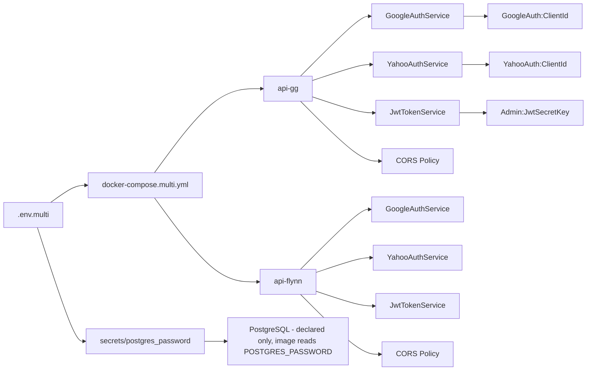

# Production Environment Setup

## Overview

This document provides the production `.env` file and deployment instructions for the Linux server.

> **⚠ PARTIALLY SUPERSEDED — read before running anything here.** The compose commands in this
> document use `docker compose -f docker-compose.yml -f docker-compose.prod.yml`, which brings up
> the **retired** single-site stack (`artgallery-postgres-prod`, one `artgallery` database, flat
> `nginx/ssl/` cert directory). The current production path is `deploy-multi.sh` +
> `docker-compose.multi.yml`, documented in
> [`../docker-compose/DEPLOYMENT_GUIDE.md`](../docker-compose/DEPLOYMENT_GUIDE.md). The
> environment-variable mapping below is still useful reference, but check each key against
> `.env.multi.example` before applying it — several names and defaults have changed.

> **⚠ THE DATABASE IS POSTGRESQL, NOT SQL SERVER.** Every mention of *SQL Server*,
> `SQLSERVER_SA_PASSWORD`, and `secrets/sqlserver_sa_password` below is a leftover from an earlier
> design and describes nothing that exists in this repo. Both `DbContext`s register with
> `UseNpgsql` ([`EF/Extensions.cs:42`](ServerApp/ServerApp.Infrastructure/EF/Extensions.cs:42)),
> the image is `postgres:17-alpine`, and the only declared secret is `secrets/postgres_password`.
> Following the SQL Server steps verbatim creates an unused file and leaves the real credential
> unset, so the API cannot reach the database.

**IMPORTANT:** When you pull code changes from GitHub, the `.env` files are NOT included (they are gitignored). You must manually create/update them on your Linux server based on the configuration keys used in the code.

---

## Code-to-Environment Variable Mapping

The following table lists the configuration keys referenced in the codebase and their environment variables.

> **On the current multi-site stack these keys are per-site, not global.** `docker-compose.multi.yml`
> reads a `GG_`-prefixed set for `api-gg` and a `FLYNN_`-prefixed set for `api-flynn`
> (e.g. `GG_GOOGLE_AUTH_CLIENT_ID` / `FLYNN_GOOGLE_AUTH_CLIENT_ID`), declared in `.env.multi`,
> `.env.multi.example` and `.env.multi.arm64.example`. The unprefixed names below belong to the
> **retired** single-site files only.

| Code Location | Configuration Key | Docker Compose Variable | .env Variable (single-site) | Required |
|--------------|-------------------|------------------------|----------------------------|----------|
| [`GoogleAuthService.cs:24`](ServerApp/ServerApp.Infrastructure/Services/GoogleAuthService.cs:24) | `GoogleAuth:ClientId` | `GoogleAuth__ClientId` | `GOOGLE_AUTH_CLIENT_ID` | Yes |
| [`GoogleAuthService.cs:26`](ServerApp/ServerApp.Infrastructure/Services/GoogleAuthService.cs:26) | `GoogleAuth:ClientSecret` | `GoogleAuth__ClientSecret` | `GOOGLE_AUTH_CLIENT_SECRET` | Yes |
| [`GoogleAuthService.cs:28`](ServerApp/ServerApp.Infrastructure/Services/GoogleAuthService.cs:28) | `GoogleAuth:RedirectUri` | `GoogleAuth__RedirectUri` | `GOOGLE_AUTH_REDIRECT_URI` | Yes |
| [`YahooAuthService.cs:27`](ServerApp/ServerApp.Infrastructure/Services/YahooAuthService.cs:27) | `YahooAuth:ClientId` | `YahooAuth__ClientId` | `YAHOO_AUTH_CLIENT_ID` | Yes, if Yahoo login is used |
| [`YahooAuthService.cs:29`](ServerApp/ServerApp.Infrastructure/Services/YahooAuthService.cs:29) | `YahooAuth:ClientSecret` | `YahooAuth__ClientSecret` | `YAHOO_AUTH_CLIENT_SECRET` | Yes, if Yahoo login is used |
| [`YahooAuthService.cs:31`](ServerApp/ServerApp.Infrastructure/Services/YahooAuthService.cs:31) | `YahooAuth:RedirectUri` | `YahooAuth__RedirectUri` | `YAHOO_AUTH_REDIRECT_URI` | Yes, if Yahoo login is used |
| [`JwtTokenService.cs:20`](ServerApp/ServerApp.Infrastructure/Services/JwtTokenService.cs:20) | `Admin:JwtSecretKey` | `Admin__JwtSecretKey` | `ADMIN_JWT_SECRET_KEY` | Yes |
| [`JwtTokenService.cs:22`](ServerApp/ServerApp.Infrastructure/Services/JwtTokenService.cs:22) | `Admin:JwtExpiryMinutes` | `Admin__JwtExpiryMinutes` | `ADMIN_JWT_EXPIRY_MINUTES` | No (default: 60) |
| [`Program.cs:50`](ServerApp/ServerApp.Api/Program.cs:50) | `Admin:AuthorizedEmails` | `Admin__AuthorizedEmails` | `ADMIN_AUTHORIZED_EMAILS` | Yes |
| [`Program.cs:33`](ServerApp/ServerApp.Api/Program.cs:33) | `CORS_ALLOWED_ORIGINS` | `CORS_ALLOWED_ORIGINS` | `CORS_ALLOWED_ORIGINS` | Yes |
| [`EF/Extensions.cs:38`](ServerApp/ServerApp.Infrastructure/EF/Extensions.cs:38) | `ConnectionStrings:DefaultConnection` | `ConnectionStrings__DefaultConnection` | `POSTGRES_PASSWORD` (interpolated into the connection string) | Yes |

### Where these are wired up in the retired single-site compose file

Line numbers re-verified against the current file; the citations in this section were previously
off by seven lines.

| Compose File Line | Docker Compose Variable | Notes |
|-------------------|------------------------|-------|
| [`prod.yml:46`](docker-compose/docker-compose.prod.yml:46) | `ConnectionStrings__DefaultConnection` | `Database=artgallery` (single DB) |
| [`prod.yml:48-50`](docker-compose/docker-compose.prod.yml:48) | `GoogleAuth__ClientId` / `ClientSecret` / `RedirectUri` | |
| [`prod.yml:51`](docker-compose/docker-compose.prod.yml:51) | `Admin__JwtSecretKey` | |
| [`prod.yml:52`](docker-compose/docker-compose.prod.yml:52) | `Admin__JwtExpiryMinutes` | defaults to 60 |
| [`prod.yml:53`](docker-compose/docker-compose.prod.yml:53) | `Admin__AuthorizedEmails` | |

> **`docker-compose.prod.yml` carries no `YahooAuth__*` keys at all.** `YahooAuthService` throws
> `ArgumentNullException` in its constructor when they are missing, and it is registered as a scoped
> service unconditionally ([`Extensions.cs:70`](ServerApp/ServerApp.Infrastructure/Extensions.cs:70)),
> so Yahoo login cannot work on the retired single-site stack. The multi-site files do supply them
> ([`multi.yml:68-70`](docker-compose/docker-compose.multi.yml:68),
> [`:177-179`](docker-compose/docker-compose.multi.yml:177)).

### Naming Convention

Docker Compose uses double underscore (`__`) to represent nested configuration sections:
- `.env` variable: `GOOGLE_AUTH_CLIENT_ID`
- Docker Compose env: `GoogleAuth__ClientId`
- .NET config key: `GoogleAuth:ClientId`

---

## File Locations

| File | Location | Purpose |
|------|----------|---------|
| `docker-compose/.env.multi` | Per-site env for the **current** stack (`GG_` / `FLYNN_` keys) | Read by `api-gg`, `api-flynn`, and both frontends |
| `docker-compose/.env` | Single-site env for the **retired** `docker-compose.yml` + `docker-compose.prod.yml` | Legacy only — editing it changes nothing that runs |
| `docker-compose/secrets/postgres_password` | Secret file declared by [`multi.yml:324-326`](docker-compose/docker-compose.multi.yml:324) | Postgres password (see note below) |
| `clientapp/.env.production` | Next.js production env | Built into the frontend bundle |

> **About `secrets/postgres_password`:** the official `postgres` image **ignores `*_FILE`
> variables**, so this secret is declared but not consumed — the container takes its password from
> the `POSTGRES_PASSWORD` environment variable instead
> ([`multi.yml:24-27`](docker-compose/docker-compose.multi.yml:24)). The file still has to *exist*,
> because Compose resolves every declared secret file and `deploy-multi.sh:52-54` aborts when it is
> missing. Its contents must match `POSTGRES_PASSWORD` byte for byte.

---

## Step 1: Create `docker-compose/.env`

Create the file at `docker-compose/.env` on your Linux server:

```bash
# ============================================================================
# Production Environment Configuration
# ============================================================================
# IMPORTANT: This file contains secrets and is gitignored.
# DO NOT commit this file to source control.
# ============================================================================

# PostgreSQL Configuration
# The database is PostgreSQL 17 accessed via Npgsql — there is no SQL Server in this project.
# This value must match the contents of secrets/postgres_password exactly.
POSTGRES_PASSWORD=YOUR_SECURE_POSTGRES_PASSWORD_HERE

# CORS Configuration
# Production domain
CORS_ALLOWED_ORIGINS=https://ggpaintings.com

# API Configuration
API_PORT=8080

# Frontend Configuration
FRONTEND_PORT=3000

# ============================================================================
# API URL Configuration
# ============================================================================
# Production: Browser accesses API via NGINX at same domain (no CORS issues)
NEXT_PUBLIC_API_URL=https://ggpaintings.com/api
SERVER_API_URL=http://api:8080/api

# ============================================================================
# OAuth Configuration for Admin Login
# ============================================================================
# Credentials from Google Cloud Console
GOOGLE_AUTH_CLIENT_ID=your_google_oauth_client_id_here
GOOGLE_AUTH_CLIENT_SECRET=your_google_oauth_client_secret_here
GOOGLE_AUTH_REDIRECT_URI=https://ggpaintings.com/api/auth/google/callback

# Yahoo OAuth — note that the retired single-site compose files define no YahooAuth__*
# variables, so these keys are inert there. On the multi-site stack the equivalent
# keys are GG_YAHOO_AUTH_* / FLYNN_YAHOO_AUTH_*.
YAHOO_AUTH_CLIENT_ID=your_yahoo_client_id_here
YAHOO_AUTH_CLIENT_SECRET=your_yahoo_client_secret_here
YAHOO_AUTH_REDIRECT_URI=https://ggpaintings.com/api/auth/yahoo/callback

# ============================================================================
# Admin Authentication Configuration
# ============================================================================
# JWT Secret Key - Generate with: openssl rand -base64 64
# Replace the value below with your own generated secret
ADMIN_JWT_SECRET_KEY=YOUR_GENERATED_JWT_SECRET_KEY_HERE
ADMIN_JWT_EXPIRY_MINUTES=60
# Comma-separated list of authorized admin email addresses
ADMIN_AUTHORIZED_EMAILS=YOUR_ADMIN_EMAIL_HERE

# ============================================================================
# NGINX Configuration (Production Only)
# ============================================================================
NGINX_HTTP_PORT=80
NGINX_HTTPS_PORT=443
NGINX_HEALTH_PORT=8080
```

---

## Step 2: Generate JWT Secret Key

Run this command on your Linux server to generate a secure JWT secret:

```bash
openssl rand -base64 64
```

Copy the output and replace `YOUR_GENERATED_JWT_SECRET_KEY_HERE` in the `.env` file.

---

## Step 3: Create the PostgreSQL Password Secret File

```bash
# Create the secrets directory if it doesn't exist
mkdir -p docker-compose/secrets

# Write the Postgres password to the secret file (no trailing newline).
# This must be the SAME value you put in POSTGRES_PASSWORD.
printf '%s' 'YOUR_SECURE_POSTGRES_PASSWORD_HERE' > docker-compose/secrets/postgres_password

# Set restrictive permissions
chmod 600 docker-compose/secrets/postgres_password
```

---

## Step 4: Update Authorized Admin Emails

Replace `YOUR_ADMIN_EMAIL_HERE` with the actual Google email address(es) authorized to log in as admin:

```bash
ADMIN_AUTHORIZED_EMAILS=admin@example.com,admin2@example.com
```

---

## Step 5: Verify Git Ignore

The following files are already configured to be ignored by Git:

| File | Gitignore Location |
|------|-------------------|
Line numbers re-verified against the current files.

| File | Gitignore Location |
|------|-------------------|
| `docker-compose/.env` | `docker-compose/.gitignore` line 2 |
| `docker-compose/.env.multi` | `docker-compose/.gitignore` line 5 |
| `docker-compose/.env.multi.arm64` | `docker-compose/.gitignore` line 6 |
| `docker-compose/secrets/*` | `docker-compose/.gitignore` line 9 (with `!secrets/.gitkeep` on line 10) |
| `clientapp/.env*` | `clientapp/.gitignore` line 34 |
| `*.env` | Root `.gitignore` line 7 |

> `.gitignore` is **inert for paths that are already tracked**. Verified with
> `git ls-files` and `git log --all`: `docker-compose/.env.multi` and
> `docker-compose/secrets/postgres_password` have never been committed, so the ignore rules above
> are actually in force for them. Re-run this check after adding any new secret file.

Verify with:

```bash
git status --ignored -- docker-compose/.env docker-compose/secrets/
```

---

## Step 6: Deploy

```bash
# Navigate to the docker-compose directory
cd docker-compose

# Current production deploy (multi-site) — this is the path to use:
bash deploy-multi.sh

# Retired single-site stack — DO NOT run on a host that uses, or is moving to, the
# multi-site stack. It starts artgallery-postgres-prod with a single `artgallery`
# database, expects a flat nginx/ssl/ cert directory, and uses `api` / `frontend`
# service names. Kept here only so the env-var mapping above can be traced back to the
# compose file it described.
docker compose -f docker-compose.yml -f docker-compose.prod.yml up -d --build
```

---

## Environment Variable Mapping

Here is how each environment variable flows from `.env` to the application:

Current multi-site flow (one env file, two prefixed key sets, two API containers):



### Variable Name Mapping

Single-site names (retired files). On the multi-site stack, prefix each with `GG_` and `FLYNN_`
and use the same `Service__Key` target for `api-gg` / `api-flynn` respectively.

| .env Variable | Docker Compose Variable | .NET Configuration Key | Used By |
|--------------|------------------------|----------------------|---------|
| `GOOGLE_AUTH_CLIENT_ID` | `GoogleAuth__ClientId` | `GoogleAuth:ClientId` | GoogleAuthService |
| `GOOGLE_AUTH_CLIENT_SECRET` | `GoogleAuth__ClientSecret` | `GoogleAuth:ClientSecret` | GoogleAuthService |
| `GOOGLE_AUTH_REDIRECT_URI` | `GoogleAuth__RedirectUri` | `GoogleAuth:RedirectUri` | GoogleAuthService |
| `YAHOO_AUTH_CLIENT_ID` | `YahooAuth__ClientId` | `YahooAuth:ClientId` | YahooAuthService |
| `YAHOO_AUTH_CLIENT_SECRET` | `YahooAuth__ClientSecret` | `YahooAuth:ClientSecret` | YahooAuthService |
| `YAHOO_AUTH_REDIRECT_URI` | `YahooAuth__RedirectUri` | `YahooAuth:RedirectUri` | YahooAuthService |
| `ADMIN_JWT_SECRET_KEY` | `Admin__JwtSecretKey` | `Admin:JwtSecretKey` | JwtTokenService |
| `ADMIN_JWT_EXPIRY_MINUTES` | `Admin__JwtExpiryMinutes` | `Admin:JwtExpiryMinutes` | JwtTokenService |
| `ADMIN_AUTHORIZED_EMAILS` | `Admin__AuthorizedEmails` | `Admin:AuthorizedEmails` | LoginWithGoogleHandler, LoginWithYahooHandler |
| `CORS_ALLOWED_ORIGINS` | `CORS_ALLOWED_ORIGINS` | `CORS_ALLOWED_ORIGINS` | Program.cs CORS policy |
| `POSTGRES_PASSWORD` | Interpolated into `ConnectionStrings__DefaultConnection` | `ConnectionStrings:DefaultConnection` | Npgsql / PostgreSQL 17 |

---

## Troubleshooting

### OAuth Callback Fails with "redirect_uri_mismatch"

Ensure the redirect URI in Google Cloud Console exactly matches:
```
https://ggpaintings.com/api/auth/google/callback
```

### JWT Token Not Validated

Verify the JWT secret key is the same in:
1. `docker-compose/.env` - `ADMIN_JWT_SECRET_KEY`
2. Used by both `JwtTokenService` for generation and validation

### CORS Errors

Ensure `CORS_ALLOWED_ORIGINS` includes your production domain:
```
CORS_ALLOWED_ORIGINS=https://ggpaintings.com
```

### Database Connection Fails

There is no SQL Server in this stack — the database is PostgreSQL 17 in the `artgallery-postgres`
container. Verify:

1. `POSTGRES_PASSWORD` matches the contents of `secrets/postgres_password` (no trailing newline).
2. The connection string names the right database for the site: `artgallery_gg` for `api-gg`,
   `artgallery_flynn` for `api-flynn`. The retired single-site files use `artgallery`.
3. The container is healthy: `docker ps | grep postgres`
4. The database actually exists — on a fresh volume it is created by
   `scripts/init-databases.sql`. An existing volume restored from a single-site backup will *not*
   contain the per-site databases, so create them before starting the APIs.

---

## Security Checklist

- [ ] JWT secret key is 64+ characters and randomly generated
- [ ] Postgres password is 14+ characters with mixed complexity
- [ ] `.env.multi` (and any `.env`) is not committed to Git — confirm with `git ls-files`, not
      just by the presence of an ignore rule
- [ ] `secrets/postgres_password` has `600` permissions
- [ ] Only authorized admin emails are listed
- [ ] Google and Yahoo OAuth client secrets are not exposed in client-side code
- [ ] NGINX SSL certificates are in place at `docker-compose/nginx/ssl/`
